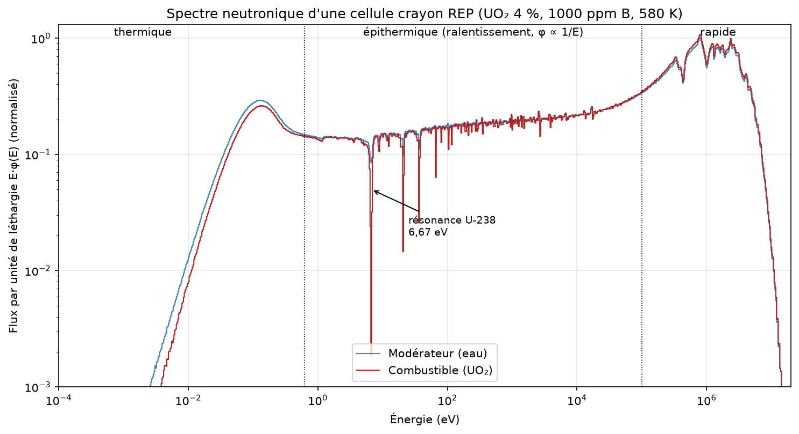

# Neutronique d'un cœur REP avec OpenMC

Étude neutronique progressive d'un réacteur à eau pressurisée (REP), du crayon combustible
isolé jusqu'à l'assemblage 17×17 et à son évolution sous irradiation, réalisée avec le code
Monte-Carlo [OpenMC](https://docs.openmc.org/).

> Projet personnel d'apprentissage — étudiant ingénieur, spécialisation nucléaire.

## Objectif

Construire, étape par étape, des modèles neutroniques de complexité croissante et interpréter
physiquement les résultats :

1. **Cellule crayon** (*pin cell*) : facteur de multiplication infini k∞ et spectre neutronique.
2. **Études paramétriques** : sensibilité de k∞ à l'enrichissement, à la concentration en bore
   et à la température du modérateur (coefficient de température).
3. **Assemblage REP 17×17** : tubes guides, carte de puissance crayon par crayon.
4. **Épuisement** : évolution de k∞ avec le burn-up et production de plutonium.

## Méthode

- **Code** : OpenMC 0.16 — transport des neutrons par méthode Monte-Carlo en énergie continue.
- **Données nucléaires** : bibliothèque ENDF/B-VIII.0 au format HDF5, fournie par l'équipe OpenMC.
- **Calcul de criticité** : itérations sur les sources de fission (cycles inactifs pour converger
  la source, cycles actifs pour accumuler les statistiques) ; chaque résultat est donné avec
  son incertitude statistique (1σ).
- **Organisation** : un notebook par étude dans `notebooks/`, fonctions communes dans `src/`.

## Résultats

| Étude | Notebook | Résultat principal |
|---|---|---|
| Cellule crayon UO₂ 4 % | [`01_pin_cell.ipynb`](notebooks/01_pin_cell.ipynb) | k∞ = 1,2647 ± 0,0006 (1σ), à 1000 ppm de bore et 580 K |
| Enrichissement et bore | [`02a_enrichissement_bore.ipynb`](notebooks/02a_enrichissement_bore.ipynb) | Bore critique (réseau infini, UO₂ 4 %) : 5032 ± 9 ppm par ajustement, 5029 ppm par recherche GRsecant ; efficacité du bore ≈ −5,4 pcm/ppm |
| Coefficients de température | `02b_…`, `02c_…` | … |
| Assemblage 17×17 | `03_…` | … |
| Épuisement | `04_…` | … |

### Spectre neutronique d'une cellule crayon



Flux par unité de léthargie : bosse thermique (~0,1 eV), plateau de ralentissement en 1/E creusé par les
résonances de capture de l'U-238 (6,67, 20,9, 36,7 eV…), plus marquées dans le combustible (autoprotection),
et pic des neutrons de fission vers 1–2 MeV.

## Structure du dépôt

```text
.
├── notebooks/        # études, numérotées dans l'ordre de lecture
├── src/              # fonctions Python réutilisables (matériaux, géométries…)
├── results/          # figures et tableaux exportés
├── docs/             # plan du projet, notes de méthode
└── environment.yml   # environnement conda reproductible
```

## Reproduire les calculs

### 1. Environnement

```bash
conda env create --platform osx-64 -f environment.yml   # macOS Apple Silicon (via Rosetta 2)
conda env create -f environment.yml                     # Linux / macOS Intel
conda activate openmc-env
```

OpenMC n'est pas distribué pour `osx-arm64` sur conda-forge : sur Mac Apple Silicon, on installe
la version Intel, exécutée de manière transparente par Rosetta 2.

### 2. Données nucléaires

Télécharger la bibliothèque **ENDF/B-VIII.0** (≈ 3,4 Go compressés, 13 Go décompressés) depuis
[openmc.org/data](https://openmc.org/data/), l'extraire hors du dépôt, puis indiquer son index à OpenMC :

```bash
mkdir -p ~/nuclear_data && cd ~/nuclear_data
tar -xJf endfb-viii.0-hdf5.tar.xz
export OPENMC_CROSS_SECTIONS=~/nuclear_data/endfb-viii.0-hdf5/cross_sections.xml
```

(ajouter la ligne `export` à `~/.zshrc` ou `~/.bash_profile` pour la rendre permanente).

### 3. Exécution

Ouvrir les notebooks dans VS Code ou Jupyter avec le noyau `openmc-env` et les exécuter dans l'ordre.
Les fichiers XML et HDF5 produits par OpenMC ne sont pas versionnés : ils sont régénérés à chaque exécution.

## Références

- P. K. Romano et al., *OpenMC: A state-of-the-art Monte Carlo code for research and development*,
  Annals of Nuclear Energy 82 (2015) 90–97.
- D. A. Brown et al., *ENDF/B-VIII.0: The 8th Major Release of the Nuclear Reaction Data Library*,
  Nuclear Data Sheets 148 (2018) 1–142.
- Documentation OpenMC : <https://docs.openmc.org/>
- Exemples officiels OpenMC : <https://github.com/openmc-dev/openmc/wiki/Example-Jupyter-Notebooks>
- Plan détaillé des études à venir : [`docs/plan.md`](docs/plan.md)
